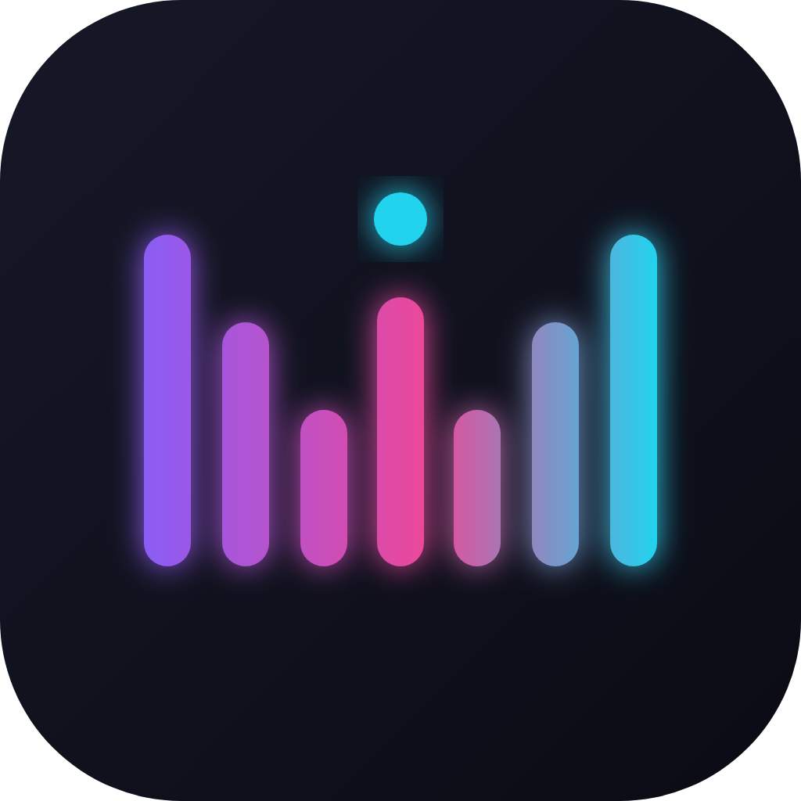

# Wavelength: Build Plan

*The music player that learns your taste.*

**Platform:** Android (native Kotlin, Jetpack Compose UI, Media3/ExoPlayer, Room database)
**Cost:** Free. There are no paid services, subscriptions or ads in Wavelength itself.

---

## Core principles
1. **Everything happens inside Wavelength.** It never creates, edits or clutters anything in your Spotify account, and it never sends you to another app to listen.
2. **Your listening data stays on your phone.** Only song and artist names are sent online, to find similar music, and you can turn that off.
3. **Free only.** Last.fm, Deezer and ListenBrainz are free to use, and Spotify playback goes through your existing Spotify account.

---

## Features

### 1. Music player (VLC-level)
- Automatically scans the phone for MP3, FLAC, M4A/AAC, OGG, OPUS and WAV files, and you can exclude folders
- Browse by Songs, Albums, Artists, Genres or Folders, and search across all of them
- Background playback, lock-screen and notification controls, Bluetooth, headset and car buttons
- Gapless playback, equalizer and bass boost, playback speed, sleep timer, lyrics (embedded or .lrc files), home-screen widget

### 2. Playlists, shuffle and loop
- Create, rename, reorder and delete playlists, and import or export .m3u files
- **Loop modes:** Off, Loop One or Loop Playlist
- **Smart shuffle with no repeats:**
  - A song can't come back until most of the playlist has played (70% by default, adjustable)
  - Two songs by the same artist won't play back to back
  - Each loop reshuffles, but never starts with the songs that ended the previous round
- **Shuffle styles:**
  - **True Random**
  - **Smart:** favours songs you like and plays songs you often skip less
  - **Discovery:** favours songs you rarely play

### 3. Listening tracker
For every song, from your phone or from Spotify, Wavelength records:

| Tracked | Rule |
|---|---|
| Play count | Counts when you hear at least 50% of the song or 4 minutes |
| Skip count | Counts when you move on before 30 seconds |
| Listen time & % completed | Recorded for every play |
| Replays, favourites, last played, time of day | Recorded |

- Each song gets an **Affinity Score** that goes up with full plays, replays and favourites, and down with early skips. Recent behaviour counts more.
- **Stats screen:** top songs, artists and genres; most skipped; weekly listening hours; forgotten favourites.

### 4. Discover: finding new similar songs
1. **Seeds:** your highest-Affinity songs and artists. Artists you often skip count as "less of this."
2. **Lookup:** song and artist names are sent to Last.fm, the main source (similar tracks and artists). Deezer and ListenBrainz are backup sources.
3. **Ranking:**
   - Songs recommended because of several of your favourites rank higher
   - Songs you already have are removed
   - Artists you usually skip are pushed down
   - Songs you've thumbed down never come back
4. **Display:** grouped as "Because you like …", "Fresh for you" and "New artists."
5. **Actions:** play the full song through Spotify, 👍/👎 it, or save it to the Wishlist.
6. **Learning:** how you react to Discover songs (full listens, skips, thumbs) feeds back into the next batch.

### 5. Spotify inside Wavelength (no Spotify playlists)
- Wavelength stores **its own playlists inside the app**, for example *Discover Weekly-style mixes* and *Hidden Gems*. They hold Spotify song links but **never touch your Spotify library**.
- Playback uses Spotify's **official Android remote-control kit (App Remote SDK)**. The Spotify app plays the audio quietly in the background while you stay in Wavelength, using Wavelength's controls, queue, shuffle and loop.
- Wavelength runs the queue itself, one song at a time, so smart shuffle and the no-repeat rules work for Spotify songs too.
- Skips and listen time on Spotify songs are tracked exactly like local songs.
- **Requirements:** the Spotify app installed and logged in, and **Spotify Premium**. Spotify only lets other apps play a specific song on request for Premium accounts; on Free it forces shuffle and ads.
- Spotify may still list these plays in its own "recently played" history. That's on Spotify's side and doesn't create or change any playlists.

### 6. Automatic playlists from your own library
- **On Your Wavelength:** your top-Affinity songs
- **Hidden Gems:** songs similar to your favourites that you've rarely played
- **Never Played:** music you have but haven't listened to
- **Rediscover:** old favourites you haven't played in a while
- **Skip Graveyard:** songs you almost always skip
- **Time-of-day mixes:** built from what you usually play at that hour

### 7. Design
- Dark theme by default, with the logo's violet (#8B5CF6), pink (#EC4899) and cyan (#22D3EE) as accent colours
- Large album art on Now Playing, with the background tinted to match the art

---

## Build phases
| # | Phase | Needs anything from you? |
|---|---|---|
| 0 | ✅ Project setup + automatic APK builds published to **GitHub Releases** | Release signing secrets (see below) |
| 1 | ✅ Library scan, browse and search, background playback | No |
| 2 | Playlists, queue, smart shuffle and loop | No |
| 3 | Listening tracker, Affinity Score, stats | No |
| 4 | Discover (Last.fm, Deezer, ListenBrainz), thumbs, Wishlist | Last.fm API key, entered in app settings |
| 5 | Spotify playback inside Wavelength | Spotify Premium + Spotify Client ID |
| 6 | Automatic playlists from your library | No |
| 7 | Polish: equalizer, sleep timer, lyrics, widget | No |

## Releases (where the APK appears)
- A GitHub Actions workflow builds a **signed APK** on every release and attaches it to the repo's **Releases** page, for example `Wavelength-v0.1.0.apk`.
- Every release is signed with the same key, so new versions **install over the old one and keep your stats and playlists**.
- **To install:** open the Releases page on your phone, download the APK, tap it, and allow "Install unknown apps" for your browser the first time.

## What's needed from you, and when
| Item | When | How |
|---|---|---|
| Android version | ✅ Android 17 (API 37) | |
| 4 GitHub repository secrets for app signing | Phase 0 | I generate the key; you paste the values into GitHub → Settings → Secrets and variables → Actions |
| Allow GitHub Actions to create releases | Phase 0 | GitHub → Settings → Actions → General → Workflow permissions → "Read and write" |
| Free Last.fm API key | Phase 4 | Create it at last.fm/api, then paste it into Wavelength's settings (not in chat) |
| Spotify Premium + Spotify app installed | Phase 5 | Confirm in chat |
| Spotify developer app (free) | Phase 5 | Create it at developer.spotify.com using the package name and fingerprint I give you, then tell me the **Client ID** (not a secret) |
