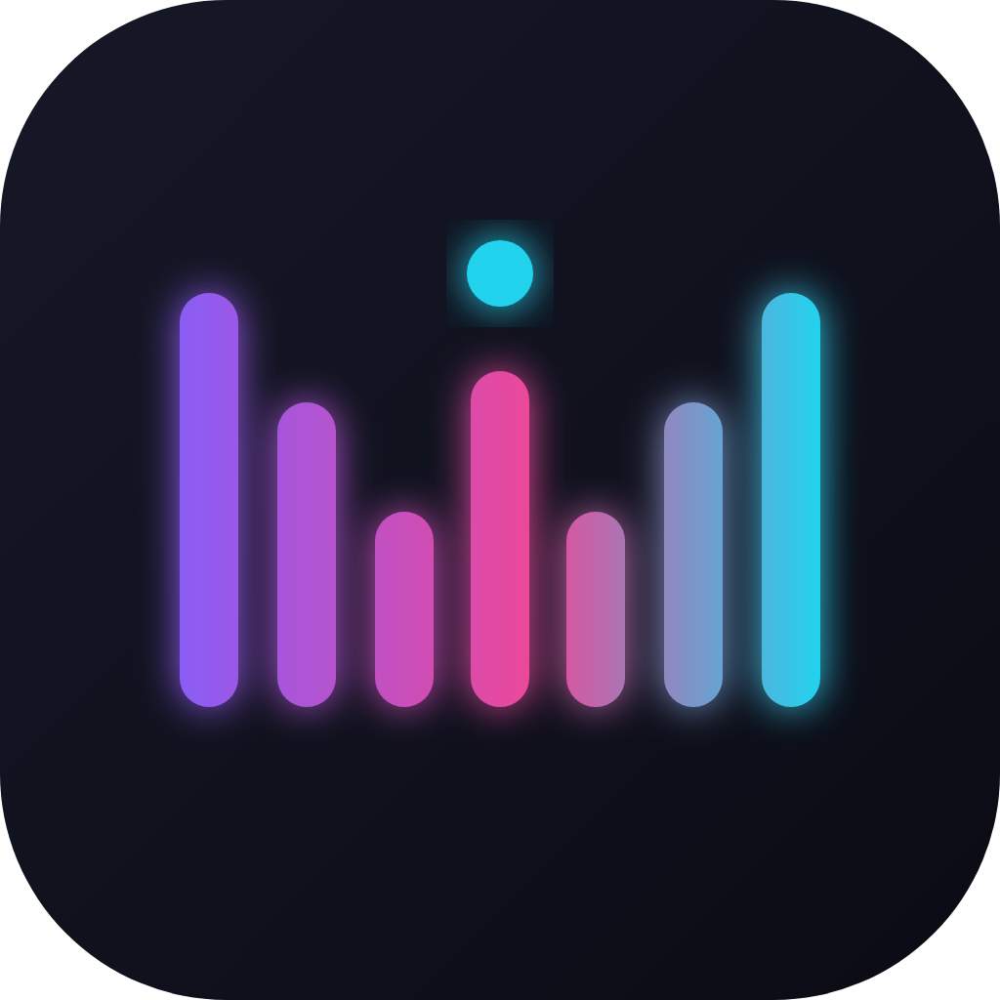

<p align="center"></p>

# Wavelength

The Android music player that learns your taste.

**Download:** get the latest APK from the [Releases page](../../releases/latest).

- Plays the music already on your phone, with albums, artists, folders, genres and search
- Smart shuffle that doesn't repeat songs too often *(coming in Phase 2)*
- Tracks plays, skips and listen time to learn what you like *(Phase 3)*
- Finds new songs similar to the ones you love *(Phase 4)*

See [PLAN.md](PLAN.md) for the full plan.

## Building it yourself
Requires JDK 21 and the Android SDK (API 37).

```bash
./gradlew assembleDebug
```
